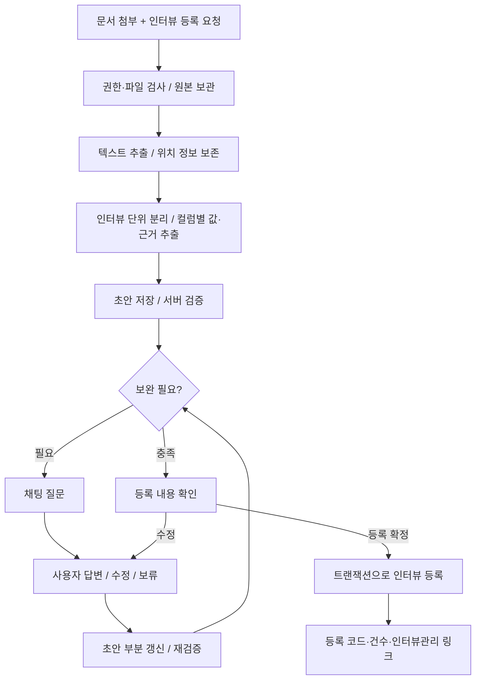

# AI 채팅 문서 기반 인터뷰 등록 파이프라인 설계

- 작성일: 2026-11-11
- 상태: 2026-11-11 사용자 “진행해”로 구현 진행. 실제 적용·검증 결과는 [구현 기록](../reports/2026-11-11-chat-intake-implementation.md) 참조.
- 추가 요청: 주간보고·이슈사항·협의요청도 같은 보완·등록 루프에 적용. 최종 확인 버튼을 사용하는 기본안을 유지한다.
- 근거: HEAD `d4453b5`와 현재 작업 파일을 읽어 확인. 진행 중인 채팅 관련 변경은 보존한다.
- 범위: 자유 형식 문서 → 인터뷰 컬럼별 초안 → 채팅 질의응답 → 인터뷰관리 등록.

## 1. 핵심 방향

사용자가 문서를 첨부하며 “인터뷰관리에 등록해 줘”라고 요청하면, 서버가 자료를 읽어 **등록 전 초안**을 만든다. 부족한 정보만 채팅에서 묻고, 답변을 기존 초안에 합쳐 등록 가능한 데이터로 완성한다.

언어 모델(LLM)은 내용 추출·답변 해석을 담당한다. 컬럼 허용 목록, 정보 충족 여부, 권한, 저장 시점, 중복 방지는 서버가 결정한다. 모든 대화를 다시 요약해서 저장값을 재생성하지 않는다.



최종 확인 방식은 제안 단계다. 기본안은 기존 채팅의 등록 확인 카드를 재사용한다. “보완 완료 즉시 자동 등록”을 선택하면 최초 요청의 등록 의사를 초안에 기록하고, 서버 검증을 통과한 같은 범위의 초안에 한해 실행한다. 등록 건수·프로젝트·대상이 달라지거나 중복 후보가 있으면 다시 확인한다.

## 2. 현재 코드에서 확인한 사항

| 항목 | 현재 동작 / 설계에 주는 영향 | 근거 |
|---|---|---|
| 채팅 파일 첨부 | xlsx·xls·csv, 5MB 제한. `/api/excel/parse`와 매핑 흐름 사용. 자유 문서 첨부는 별도 확장 필요 | `src/app/dashboard/chat/page.tsx` |
| 인터뷰 데이터 | 기본 정보와 5개 본문 항목, 비고가 존재 | `prisma/schema.prisma`의 `Interview` |
| 채팅 등록 도구 | `propose_create_record(entity=interview)` 사용 가능. 현재 허용 필드에는 `technicalConstraints`, `questions`가 없음 | `src/lib/chat-tools/entities/specs-records.ts` |
| 등록 실행 | 확인 API → `executePendingAction` → 공통 엔티티 실행기 → 화면 API 핸들러 | `src/app/api/chat/actions/[id]/confirm/route.ts`, `src/lib/chat-tools/entities/execute.ts` |
| 확인 제안 | 30분 만료. 현재 API는 업무 실행 전에 상태를 CONFIRMED로 선점함 | `src/lib/chat-tools/proposals.ts`, 확인 API |
| 대화 맥락 | 사용자·프로젝트별 최근 6턴, 긴 답변은 1,500자로 제한. 초안의 영속 저장소로 사용하기 어려움 | `src/lib/chat-agent/context.ts` |
| 인터뷰 날짜 | DB 기본값 now(), 생성 API도 누락 시 현재 날짜 사용. 이 흐름에서는 명시적 날짜 검증 필요 | Prisma 모델, `src/app/api/interviews/route.ts` |
| 채번 | 현재 생성 API는 마지막 sequence 다음 값을 사용. 동시 등록을 위한 직렬화 필요 | 인터뷰 생성 API |
| 음성 인터뷰 | 전사문을 5개 항목으로 구조화하는 모듈이 있음. 날짜 기본값·입력 절단 정책은 이번 흐름과 다름 | `src/lib/interview-audio.ts` |
| 지식 연동 | 인터뷰는 지식 수집 대상에 포함. 원본 문서 조회와 전송 대기열 코드 존재 | `src/lib/knowledge/targets.json`, `documents.ts`, `worker.ts` |

이 문서는 체크아웃의 코드 확인 결과다. 운영 서버에서 자유 문서 처리가 동작한다고 판단한 것은 아니다.

## 3. 컬럼 매핑과 정보 충족 정책

DB의 필수 여부와 대화에서 보완할 필요성은 별개다. 아래 정책은 신규 문서 등록 흐름의 제안이며 기존 수동 등록의 필수 조건을 즉시 바꾸지 않는다.

| 컬럼 | 추출 내용 | 누락·모호 시 기본 처리 |
|---|---|---|
| `projectId` | 현재 선택한 프로젝트 | 서버 컨텍스트로 고정. 없으면 프로젝트 선택 요청 |
| `title` | 인터뷰 주제 | 본문에서 요약 제목 제안 가능. 내용도 없으면 질문 |
| `interviewDate` | 실제 인터뷰 날짜 | 반드시 질문. 업로드일·오늘 날짜로 대체 금지 |
| `interviewer` | 인터뷰 진행자 | 대상자와 혼동되면 질문. 끝내 모르면 미확인 허용 |
| `interviewee` | 인터뷰 대상자·부서 | 우선 질문. 이름을 모르면 부서·역할로 답변 가능 |
| `category` | 생산·구매·자재·품질 등 업무영역 | 명확하면 매핑. 여러 후보면 선택 요청 |
| `currentProcess` | 현재 실제 운영 방식 | 핵심 보완 항목. 다른 본문과 함께 확인 |
| `painPoints` | 불편·오류·중복 업무 등 문제점 | 핵심 보완 항목. 언급 없음과 문제 없음 구분 |
| `desiredResults` | 바라는 결과·개선 방향 | 핵심 보완 항목. 문제점에서 해결책을 지어내지 않음 |
| `technicalConstraints` | 설비·인터페이스·데이터 등 제약 | 비어 있으면 선택적으로 질문, 미확인 허용 |
| `questions` | 인터뷰 당사자가 남긴 질문 | 보완용 챗봇 질문과 구분. 없으면 빈 값 허용 |
| `remarks` | 본문에 안 들어가는 참고사항 | 날짜 불명 등 해결되지 않은 중요 정보도 표시 |

- `id`, `code`, `sequence`, 이관 정보는 서버가 결정한다. 최초 이관 상태는 미이관.
- `businessUnit`은 추출·질문·전송하지 않고 DB 기본값을 사용한다.
- 진행자·대상자는 현재 문자열 컬럼이므로 프로젝트 구성원으로 강제 변환하지 않는다.
- 다섯 본문은 한 줄에 한 사실을 담되 조건·예외·수치·부정 표현을 보존한다. 예: “평균 30분, 마감일 2시간”을 “2시간 소요”로 축약하지 않는다.
- 문서에 여러 인터뷰가 있으면 날짜·대상자·주제 경계로 후보를 나누고 건수를 확인한다. 단순히 문단마다 새 인터뷰를 만들지 않는다.

**등록 가능 조건 제안:** 제목, 확정된 날짜, 본문 1개 이상이 있고 모든 충돌이 해결되어야 한다. 대상자·현행·문제점·원하는 결과는 먼저 보완을 요청하되 사용자가 명시적으로 미확인/나중 확인을 선택하면 빈 값으로 진행할 수 있다. 선택 항목 누락만으로 질문을 끝없이 반복하지 않는다. 날짜를 끝내 모르면 초안으로 보류한다. 날짜 미상의 정식 등록이 필요하면 `interviewDate` nullable 변경과 표시 정책을 별도 결정한다.

## 4. 필드별 값과 근거

초안은 최종 저장값만 보관하지 않는다. 각 필드에 다음 정보를 둔다.

```text
value: 추출하거나 답변으로 확정된 값, 또는 null
state: EXTRACTED | CONFIRMED | MISSING | AMBIGUOUS | CONFLICT | DEFERRED | NOT_APPLICABLE
sources[]: attachmentId, 문서 버전/해시, 페이지·문단·시트·행, 원문 발췌
answerRefs[]: 사용자 답변 메시지/이벤트 식별자
candidates[]: 모호하거나 충돌하는 값과 각각의 출처
```

- `EXTRACTED`: 근거가 있는 값. 최종 확인 대상에 포함하며 모든 필드를 다시 묻지 않는다.
- `MISSING`: 언급 없음. `NOT_APPLICABLE`: 사용자가 해당 없음이라고 답한 상태. `DEFERRED`: 모름/나중 확인. 서로 다르게 보존한다.
- 같은 날짜에 문서 두 곳이 서로 다른 값을 말하면 `CONFLICT`. 모델의 신뢰 점수만으로 하나를 고르지 않는다.
- 사용자의 명시적 정정을 우선하되 원래 값과 정정 이력은 남긴다. 정정이 아닌 추가 문서는 기존 확정값을 조용히 덮어쓰지 않는다.
- 모델이 만든 제목·분류·요약은 제안임을 표시한다. 원문에서 직접 추출한 사실과 구분한다.
- 원문 발췌와 위치가 실제 추출 텍스트에 있는지 서버가 검사한다. 근거를 찾지 못한 값은 재질문한다.

## 5. 질의응답 흐름

1. 첫 응답은 추출된 주제·후보 건수와 가장 중요한 보완 질문만 보여준다.
2. 한 번에 최대 3개 질문을 제시한다. 충돌, 날짜, 대상자, 핵심 본문, 선택 정보 순이다.
3. 질문은 `questionId + itemId + fieldKeys + draftRevision`으로 초안에 연결한다.
4. “10월 30일이고 대상자는 생산팀 김대리야”처럼 한 답변이 여러 필드를 채우면 함께 반영한다. 연도·역할이 모호하면 해당 부분만 다시 묻는다.
5. “기술적 제약은 없어”는 해당 없음, “제약은 아직 몰라”는 미확인으로 기록한다.
6. 새 답변은 변경 필드만 반영한다. 충족 검사는 서버가 다시 수행한다.
7. 이미 답한 질문은 반복하지 않는다. 변화가 없는 답변에는 선택지·보류 수단을 제시하고 일괄 등록 불가를 반복하지 않는다.
8. “그만”, “나중에”는 보류/취소로 처리한다. 프로젝트 변경 시 다른 프로젝트 초안을 자동으로 이어 붙이지 않는다.

예시:

> 사용자: 이 자료를 인터뷰관리에 등록해 줘. [생산 인터뷰.docx]
>
> AI: 생산실적 입력 인터뷰 1건으로 정리했어요. 현재 방식·문제점·원하는 결과는 확인했어요. 인터뷰 날짜와 대상자를 알려 주세요.
>
> 사용자: 2026년 11월 9일, 생산팀 김대리. 엑셀은 매일 쓰는 게 아니라 마감 때만 써.
>
> AI: 날짜·대상자와 엑셀 사용 시점을 반영했어요. 기술적 제약은 자료에 없어요. 추가할 내용이 있나요? [내용 입력] [없음] [미확인으로 진행]
>
> 사용자: 미확인으로 진행해.
>
> AI: 등록할 1건의 내용을 보여드릴게요. [컬럼별 내용 / 미확인 항목] [등록] [수정] [보류]

## 6. 영속 데이터 구조 제안

| 신규 모델 | 주요 데이터와 제약 |
|---|---|
| `ChatAttachment` | 사용자·프로젝트, 원본명, 서버 저장 키, MIME·크기·SHA-256, 추출 상태·버전·오류, 생성/만료 시각 |
| `ChatIntakeDraft` | 사용자·프로젝트, targetEntity=interview, 상태, revision, 등록 의사/범위, 활성 질문, actionId, 만료 시각 |
| `ChatIntakeItem` | draftId, stable itemKey, 필드별 값·근거 JSON, 품질 검증 결과, 최종 정규화 payload, interviewId. `(draftId,itemKey)` unique |
| `ChatIntakeEvent` | draftId, 요청 식별자, 순서, 질문·답변·수정·정책판정·등록 결과. `(draftId,requestId)` unique |
| `ChatIntakeSource` | draftId와 attachmentId 연결. 문서 교체·추가 이력과 사용한 추출 버전 고정 |

- 위 이름은 제안이다. 기존 `interview-audio.ts`의 `InterviewDraft` 타입과 이름을 구분한다.
- 기존 채팅에 `intakeDraftId`를 연결하고 요청·응답에 `draftId`, `revision`, `itemId`를 전달한다. 현재 채팅은 독립 대화방 키 없이 사용자·프로젝트로 맥락을 읽으므로 이 연결이 필요하다.
- 여러 초안을 동시 작업할 수 있다. “아까 자료”로 대상이 정해지지 않으면 선택하게 한다. 브라우저 임시 변수·최근 6턴에만 의존하지 않는다.
- revision 조건부 갱신으로 동시 답변을 보호한다. 오래된 화면의 답변은 409와 최신 초안을 반환한다.
- 초안·확인 제안의 수명은 분리한다. 초안은 마지막 활동 후 7일 보관을 제안하고, 기존 확인 제안은 30분 유지한다. 만료된 제안은 초안을 재검증한 뒤 새로 만든다.
- 최종 등록 후에도 항목·출처·등록 ID 연결을 보존한다. 미등록 원본/추출문은 만료 후 정리하고 등록에 사용된 원본은 등록 기록과 함께 보관하는 안이다. 삭제 시 파일·추출문·이벤트의 연계 정리와 프로젝트 삭제 정책을 구현 전에 확정한다.

상태 전이:

```text
RECEIVED → EXTRACTING → COLLECTING ↔ READY → AWAITING_CONFIRMATION → COMMITTED
                  ↘ FAILED        ↘ PAUSED / CANCELLED / EXPIRED
```

`COLLECTING ↔ READY`는 답변·추가 문서로 반복 가능하다. 확인 대기 중 수정하면 제안을 취소하고 revision을 올린다. 직접 자동 등록 정책을 선택한 경우 READY에서 COMMITTED로 진행한다. 분석 작업의 lease·재시도 횟수·오류는 별도 기록하고, 프로세스 재시작 시 미완료 작업을 복구한다.

## 7. 파일 처리와 연결 경계

- 1차 제안 형식: txt·md·docx·텍스트 PDF·xlsx·csv. 포맷마다 표·문단·페이지/행 위치를 보존한다. xls·pptx·스캔 PDF·이미지는 후속 범위로 두고, 지원 여부를 화면과 서버에서 일치시킨다.
- 스캔 PDF 등 읽을 수 없는 자료를 “분석 완료”로 처리하지 않는다. 광학 문자 인식(OCR)이 필요한 자료라고 안내하고 대체 텍스트를 받거나 작업을 보류한다. 암호 문서·잘린 추출문도 명시한다.
- 클라이언트 업로드 진입점은 프로젝트 규칙대로 `POST /api/upload`를 확장한다. `purpose=chat_interview` 분기는 프로젝트 권한·파일 서명·압축 해제 크기·페이지/문자 상한을 검사하고 attachmentId를 반환한다. 기존 이미지 업로드 응답은 유지한다.
- `saveUpload()`는 공개 URL을 반환하므로 비공개 문서에 그대로 사용하지 않는다. 같은 업로드 모듈에 비공개 저장 함수를 추가하고 `UPLOAD_ROOT/private/chat`에 보관한다. **공개 `/api/uploads/[...path]`는 정규화 후 private 하위 접근을 확장자와 무관하게 차단**한다. 원본 조회는 인증된 attachment ID 기반 API만 사용한다.
- 채팅 요청은 임의 URL·디스크 경로 대신 attachmentId만 받는다. 서버가 소유자·프로젝트·문서 버전을 검증한다.
- 추출 결과를 위치별로 나누어 구조화하고 병합한다. 긴 문서를 조용히 절단하거나 일부 검색 결과만 읽고 전체 문서 분석으로 간주하지 않는다. 누락 청크가 있으면 완성 판정을 막는다.
- 문서 본문은 자료로만 취급한다. 본문의 “즉시 등록하라” 같은 지시는 사용자 명령·도구 실행 권한으로 해석하지 않는다.
- 기존 지식 문서 목록/검색을 문서 업로드·전체 추출 API로 간주하지 않는다. 지식 서버의 추출기를 재사용하려면 프로젝트 범위·원본 버전·전체 위치 텍스트 계약을 별도로 확인한다. 1차 설계는 검색/색인 장애와 인터뷰 등록을 분리한다.
- 원본 등록 전 초안은 지식 수집 대상으로 추가하지 않는다. 정식 인터뷰 등록 후 기존 전송 대기열 경로로 연동하며, 실제 트리거/마이그레이션 적용 여부는 구현 때 확인한다.

## 8. 도구·API·서비스 연결 제안

| 연결 지점 | 역할 |
|---|---|
| `POST /api/upload` 확장 | 문서 업로드 → 비공개 attachmentId |
| `POST /api/chat` 확장 | message + attachmentIds + intakeDraftId + revision + requestId. 기존 일반 대화와 구분 |
| 신규 `start_interview_intake` 도구 | 검증된 첨부로 분석 초안 시작. 정식 인터뷰는 만들지 않음 |
| 신규 `answer_interview_intake` 도구 | 답변을 필드 patch 후보로 해석. 서버가 질문·출처·revision을 검사해 반영 |
| 신규 `prepare_interview_intake` 도구 | 품질 검사와 중복 후보 검사 후 초안 revision에 고정된 확인 제안 생성 |
| `GET /api/chat/intakes/[id]` | 진행 상태·초안·질문·등록 결과 복구 |
| `GET /api/chat/attachments/[id]` | 사용자·프로젝트 권한 검사 후 원본 다운로드 |
| 기존 확인 API 확장 | 신규 kind=`interview_intake_commit`을 트랜잭션 서비스에 위임 |
| 신규 인터뷰 저장 서비스 | 수동 생성 API와 신규 등록 흐름이 같은 검증·채번·생성 규칙 공유 |

`src/lib/chat-intake/`에 추출 계약, 인터뷰 필드 정책, 답변 병합, 검증, 저장 서비스를 분리하는 안이다. LLM의 자유 JSON을 곧바로 Prisma에 넘기지 않는다. 구조화 출력 스키마를 검사하고 알 수 없는 필드·잘못된 날짜·근거 없는 값을 거부한다. 기존 제공자 선택을 재사용하고 실제 서비스 호출은 구현 테스트 승인 범위에 맞춘다.

기존 공통 인터뷰 등록 도구의 두 누락 필드는 구현 시 함께 맞춘다. 문서 등록 의도는 초안 흐름으로 라우팅하고, 일반 도구를 통해 같은 첨부를 바로 저장하는 우회는 서버에서 막는다. 기존 수동 입력과 음성 등록 흐름은 호환을 유지한다.

## 9. 중복 방지와 원자적 등록

확인 카드의 모양을 재사용하되 현재의 “먼저 CONFIRMED → 이후 생성”만으로 저장 원자성을 확보했다고 보지 않는다. 신규 흐름에는 다음 단위를 한 PostgreSQL 트랜잭션으로 묶는다.

1. action·draft 행을 잠그고 사용자·프로젝트·상태·만료·revision·payload 해시를 확인한다. payload는 초안에서 서버가 다시 구성한다.
2. 이미 COMMITTED이면 기존 interviewId·코드를 그대로 반환한다.
3. 중복 후보 판정이 바뀌었으면 저장하지 않고 재확인을 요청한다. 날짜·대상자·제목 유사도는 후보 제시용이며 고유키로 사용하지 않는다.
4. 프로젝트 단위 잠금 아래 채번하고 인터뷰를 생성한다. 수동 API도 같은 잠금/서비스를 사용해야 동시 등록 충돌을 막을 수 있다.
5. 항목의 interviewId, 초안 COMMITTED, action CONFIRMED·resultRef, 등록 이벤트를 함께 저장한다.

트랜잭션 안에서 LLM·파일 추출·외부 지식 서버를 호출하지 않는다. 실패하면 전체 롤백한다. 커밋 후 응답이 유실되어 재요청해도 기존 결과를 조회한다. 새 확인 카드를 발급해도 같은 초안은 다시 생성되지 않게 한다.

동일 파일 해시는 재업로드 경고와 분석 재사용에 쓰되, 파일이 같다는 이유만으로 다른 인터뷰를 삭제·수정하지 않는다. 다른 초안의 중복 후보를 사용자가 새 기록으로 등록하겠다고 확인하면 허용한다.

1차는 여러 후보를 분리·보완·확인하되 **한 번에 확정한 후보 전체를 원자적으로 등록**한다. 일부만 등록하려면 사용자가 선택한 집합을 별도 초안으로 분리하고 원본 항목과의 연결을 유지한다. 부분 성공 후 나머지를 모르게 재실행하지 않는다.

## 10. 구현 순서와 확인 기준

| 단계 | 구현 범위 | 확인 기준 |
|---|---|---|
| 1 | 필드 정책·초안/출처 저장·텍스트 붙여넣기·질문/답변 | 자유 문장으로 두 필드 보완, 모름/없음 구분, 새로고침 후 복구 |
| 2 | 문서 첨부·형식별 추출·위치 근거 | 지원 형식별 실제 샘플, 긴 문서 끝부분 누락 방지, 실패 파일 안내 |
| 3 | 확인 카드·공유 저장 서비스·중복/동시성 | 중복 클릭·응답 유실·동시 수동 등록에도 중복 생성 없음 |
| 4 | 채팅에서 인터뷰관리까지 실제 흐름 확인 | 등록값·코드·건수와 인터뷰관리 화면 값 일치, 변경/보류/취소 확인 |

테스트는 실제 외부 서비스 호출 없는 고정 문서·주입형 LLM으로 수행한다. 날짜 없는 자료, 충돌하는 대상자, 기술적 제약·궁금한 점 포함 자료, 복수 인터뷰, 한 답변의 복수 필드, 이미 답한 질문, 문서 속 실행 지시, 프로젝트 간 접근, 오래된 revision, 만료 제안, 트랜잭션 실패·응답 유실을 포함한다. 마지막 실제 화면 확인은 사용자가 요청한 서버에서 수행하고, 읽기·분석 성공과 DB 등록 성공을 별도로 판정한다.

Prisma 모델 변경 후 마이그레이션·generate, API 타입·훅 타입 동기화가 필요하다. 운영 DB 변경은 배포 전에 적용하는 프로젝트 절차를 따른다. 이 문서 작성에서는 서버 기동, 실제 문서/고객 데이터 전송, DB 변경을 하지 않았다.

## 11. 선택이 필요한 정책

1. 보완 완료 뒤 최종 등록 버튼을 누를지, 최초 등록 요청 범위에서 자동 실행할지. 기본 제안은 기존 확인 카드 재사용.
2. 날짜 미상은 초안 보류를 기본으로 할지, 날짜 미상의 정식 인터뷰를 허용하도록 모델을 바꿀지.
3. 제안한 1차 파일 형식과 원본/초안 보관 기간을 실제 업무 자료에 맞춰 확정할 것.

위 내용은 최초 설계 시점의 제안이다. 후속 구현에서 채택한 구조와 남은 운영 작업은 구현 기록에서 구분한다.
